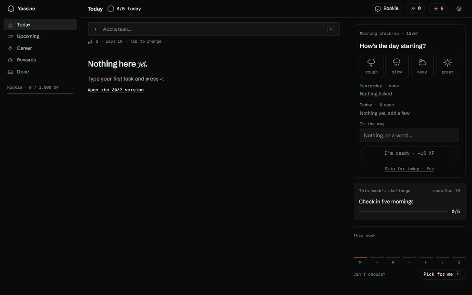

# To do, done · todo-project003

A 2021 to-do list, rebuilt in the open: Linear's calm rows, and a career you grow by finishing what you planned. Every piece was released as it landed.

**Live:** [yassinelakchouch.github.io/To_Do_List](https://yassinelakchouch.github.io/To_Do_List/) · **First version (2021):** [`/legacy/`](https://yassinelakchouch.github.io/To_Do_List/legacy/)



## The pages

| Page | For |
|---|---|
| Today | add, size (S · M · L), tick; the morning check-in, the week's challenge, quests and rewards beside the list |
| Upcoming | plan ahead by day; a task's size, label and day in its detail |
| Career | your league on the track, every quest, your best days on a podium, the week |
| Rewards | treats you set and price in sparks; redeem, with Undo |
| Done | finished tasks by day, with what each day earned |

A first visit asks your name, shows how it works, tours the five pages and offers five sample tasks. Settings hold the day's goal, the week's first day (Monday or Sunday), the check-in, sound, motion, export and a reset you confirm by typing.

## How it pays

- **A task:** S 10 · M 20 · L 30, as XP (your league) and sparks (what rewards cost).
- **A chain:** two ticks within 90 s pay ×2, three or more ×3.
- **Bonuses:** the morning check-in +15; the day's goal +20; each quest tier +25 XP; the week's challenge +50.
- **Unticking or undoing** takes back exactly what it gave: points are worked out from the list, never kept as a running total.

## Keys

| Key | Does |
|---|---|
| C | add a task (Tab sizes it while typing) |
| X · E · ⌫ | done / not done · edit in place · delete |
| J · K | move through the list |
| D · M | plan for tomorrow (Today) · move to Today (Upcoming) |
| P | pick for me: a slot lands on an open task |
| Z | undo, on every page |
| ⌘K · ? | every action by name · this list |

## Motion and sound

GSAP and Web Audio:
- **Tick:** the gain flies to the spark pill as the counts roll, with a bright tick.
- **Chain:** ×2 slides out and fades after 90 quiet seconds.
- **Quest tier:** the next fifth of the emblem draws clockwise.
- **Pick for me:** the slot spins about 0.8 s.
- **Redeem:** the stamp drops with a small overshoot.
- **League up:** the crest draws in with a short fanfare; on your next Career visit the athlete morphs into its new pose.

The Motion and Sound switches turn each off; a reduced-motion system gets the still version.

## How it was built

1. **Measured the 2021 version first.** It was jQuery with 41 px rows and a 17 px delete target, saved nothing, and its page was 600 px wide on a 390 px phone, so delete sat off screen.
2. **Designed on boards T-01 to T-07:** study, storyboard, screens, the play (after Synergy), components, the site map with one flow per use case, then the loader and onboarding. The plan and its tasks are in [`docs/PLAN.md`](docs/PLAN.md).
3. **Released piece by piece.** 74 pull requests are merged, from the tasks reducer to the five pages; each merge to `main` redeploys the site.

## What I learned

- **Derive, don't count.** Points are worked out from the list every time, so unticking and Undo give back exactly what they took. A running total would drift the first time an undo and a chain overlap.
- **A redraw can eat a double click.** The first click re-renders the row, so Chrome never sends `dblclick`; edit-in-place reads `click.detail === 2` instead.
- **This size needs no framework.** String components, one store with an undo history and event delegation carry five pages, with 189 unit tests on the rules.

## What's next

Open on the T-07 board:
- [#70](https://github.com/yassinelakchouch/To_Do_List/issues/70) Greet you by name in the header.
- [#71](https://github.com/yassinelakchouch/To_Do_List/issues/71) Small gaps: replay from the keys sheet, 12 px text, the name note.
- [#72](https://github.com/yassinelakchouch/To_Do_List/issues/72) Draw the "Your pages" step.

## Run

```sh
npm ci
npm run dev        # http://localhost:5182
npm test           # 189 unit tests
npm run test:e2e   # 120 end-to-end tests: every use case on board T-06, on desktop and phone (keyboard-only ones skip the phone), in the installed Chrome
npm run build
```

## Stack

Vite 8 · TypeScript 7 (strict) · Tailwind CSS v4 (`@theme` tokens) · GSAP · Web Audio · `localStorage` · Vitest and Playwright. No framework: string components, one store with an undo history, event delegation.
